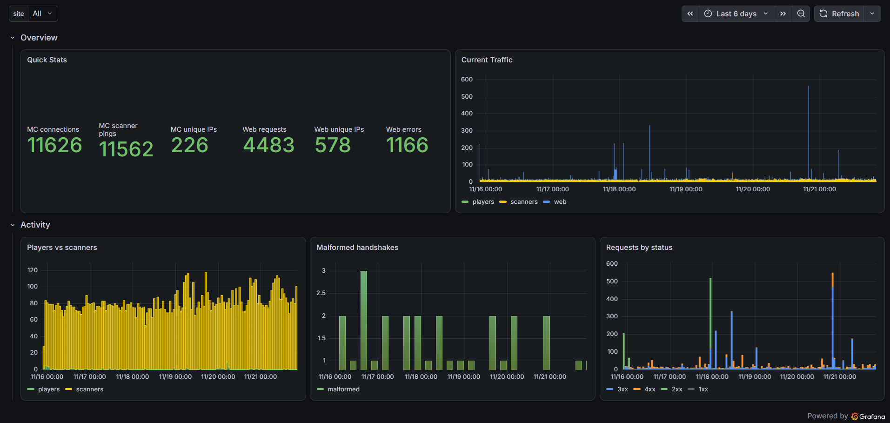
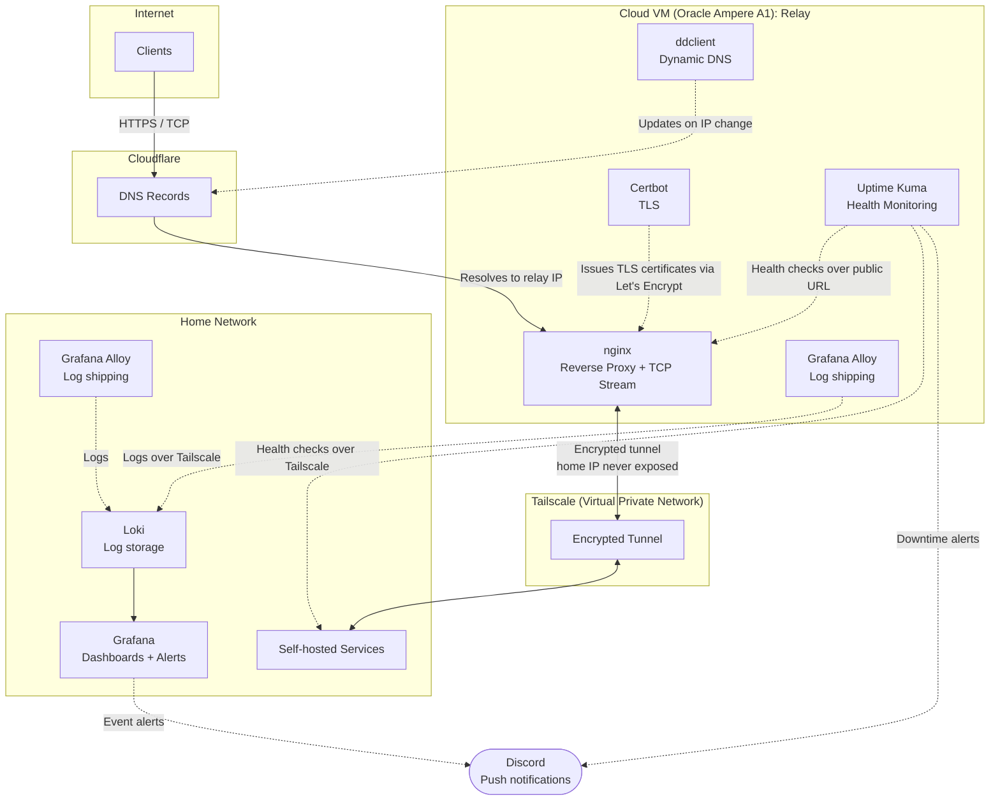

# Homelab Architecture

A self-hosted homelab (on an old Lenovo laptop) exposing services to the internet without paying for a proxying tier that supports non-HTTP traffic and without directly exposing the home network's IP address.

The simplest solution for a proxy is to use Cloudflare's proxy (the orange cloud), but it only proxies HTTP traffic on the free tier. Not wanting to pay for Cloudflare Spectrum or expose my home IP led me to build out a simple reverse proxy.

## Observability

Grafana Alloy on both machines ships logs to Loki, which Grafana uses as its data source for dashboards. Grafana alert rules fire on specific events and Uptime Kuma watches for downtime, both push notifications to Discord.

## Architecture

## Design

- **Relay VM (Oracle Cloud Ampere A1):** proxies traffic, and exposes the only public facing ports. Runs nginx for both standard HTTP(S) reverse proxying and raw TCP stream proxying, Certbot for automated TLS registration, and Uptime Kuma for monitoring.
- **Tailscale mesh:** connects the relay to the home network over an encrypted tunnel, so the home network's real IP is never exposed to the internet. Tailscale Access Control Lists configured to restrict the VM's permissions to purely forwarding traffic.
- **Dynamic DNS:** `ddclient` monitors public IP changes and updates DNS records automatically.
- **Certificate management:** TLS certificates are issued via the Let's Encrypt CA.

## Traffic / access model

### Relay VM (public-facing)

|         Service          | Port(s) |                                                       Traffic Accepted                                                       |
| :----------------------: | :-----: | :--------------------------------------------------------------------------------------------------------------------------: |
|       nginx (HTTP)       |   80    |                                                   Open, redirects to HTTPS                                                   |
|      nginx (HTTPS)       |   443   | Open to traffic, but nginx `server_name` matching rejects requests for unrecognized hostnames (closed to random IP scanning) |
| nginx (TCP stream relay) |  25565  |                                                     Open to TCP traffic                                                      |
|       Uptime Kuma        |  3001   |                                                     Tailscale peers only                                                     |
|    Grafana Alloy (UI)    |  14320  |                                                        Localhost only                                                        |

### Home network (internal, behind Tailscale)

|       Service        |  Port  |                       Traffic Accepted                        |
| :------------------: | :----: | :-----------------------------------------------------------: |
| Self-hosted services | varies | Tailscale peers only, ACLs limit the relay to forwarded ports |
|       Grafana        | 14300  |                     Tailscale peers only                      |
|         Loki         | 14310  |                     Tailscale peers only                      |
|  Grafana Alloy (UI)  | 14320  |                        Localhost only                         |

## Note

This is a sanitized public mirror of infrastructure I actually run. Non-infrastructure services, hostnames, IP addresses, and credentials have been redacted or replaced with placeholders; the configs included here are representative of the real setup but not a live copy.
